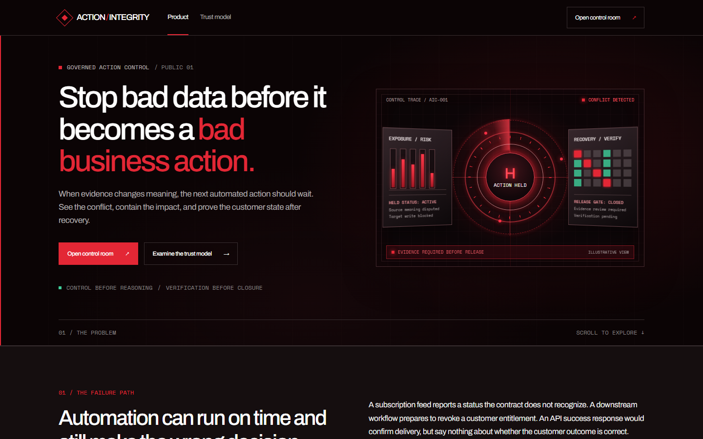
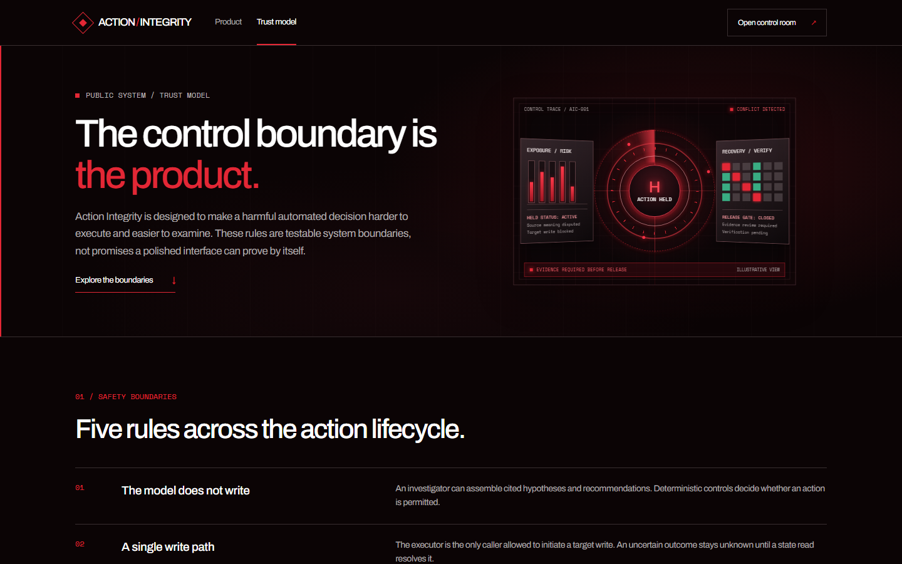
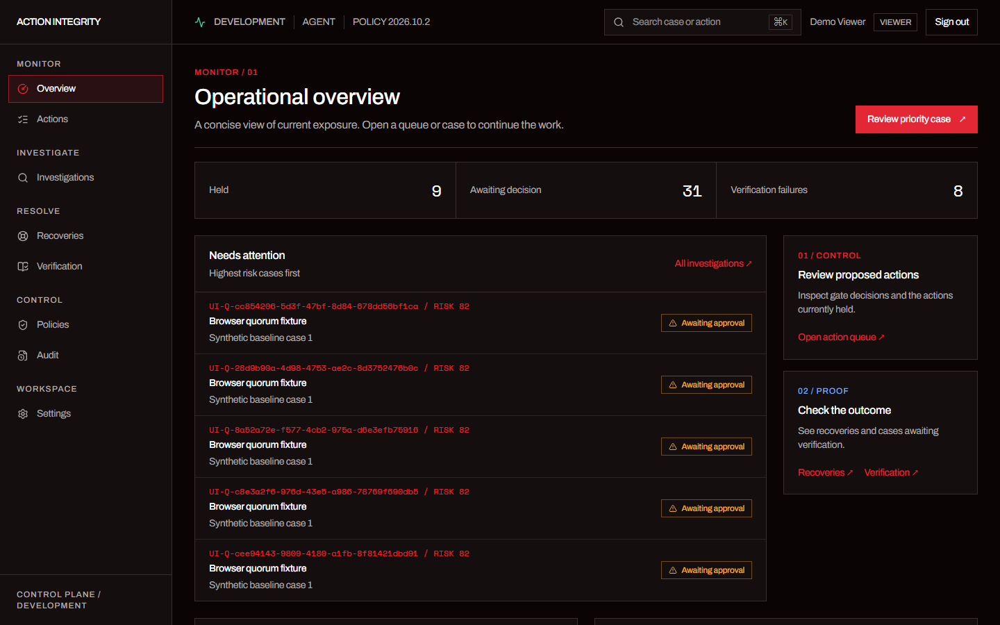
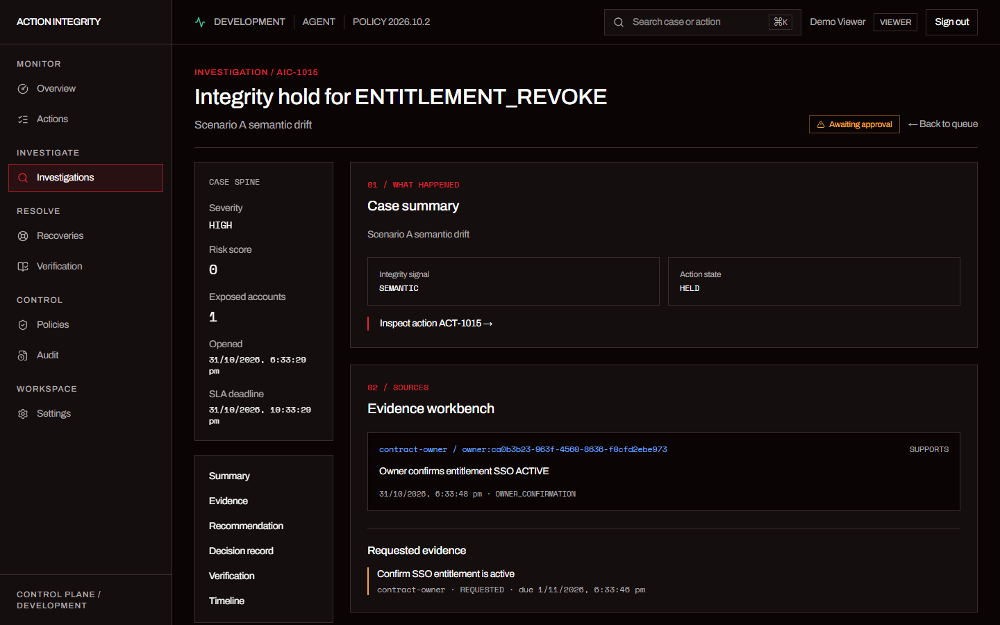
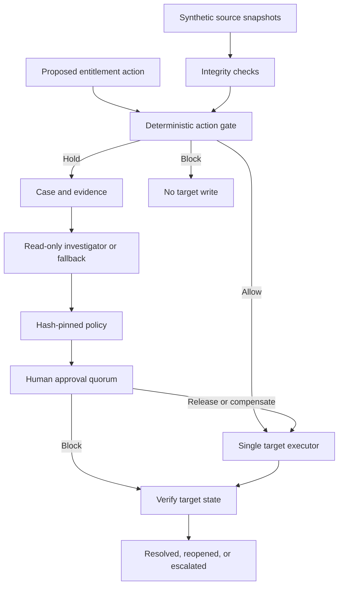

<p align="center">
  
</p>

<h1 align="center">Action Integrity</h1>

<p align="center"><strong>Evidence before action. Verification before closure.</strong></p>

<p align="center">
  <a href="#demo">Demo</a> ·
  <a href="#how-it-works">How it works</a> ·
  <a href="#run-locally">Run locally</a> ·
  <a href="#release-status">Release status</a>
</p>

Action Integrity is a governed control layer for automated business actions. It detects when source data conflicts with a declared contract, holds exposed actions, helps people investigate the evidence, and checks the business state after a decision. This repository uses a **synthetic entitlement revoke workflow** for the iOPEX Data-to-Action Integrity evaluation.

> **Current status: D0 local demonstration.** The screenshots and video use synthetic records. This is not a production deployment or a system for real customer data. See [release status](#release-status).

## Why it exists

A subscription feed can return a valid response while reporting a status the contract does not recognize. An automation may then prepare to revoke a customer's entitlement. A successful API response would show that a request was delivered; it would not prove the customer outcome was correct.

Action Integrity places a control point before that write. Operators can see the conflicting source, the action at risk, the policy decision, and the evidence required to resolve the case.

## Demo

[](docs/media/synthetic-demo.mp4)

**[Watch the 31-second synthetic walkthrough](docs/media/synthetic-demo.mp4)** · Product and Trust pages → action queue → held investigation → policy and audit views. The recording starts after a read-only viewer signs in; it contains no login credentials.

<details>
<summary>View screenshots</summary>

### Trust model



### Operator overview



### Investigation



</details>

## How it works



Every consequential transition writes an audit record. Post-commit notifications and anchoring use an outbox. The model can assemble a cited recommendation, but deterministic code owns the gate, policy, approvals, target write, and verification.

| Boundary               | Responsibility                                                                                                                           |
| ---------------------- | ---------------------------------------------------------------------------------------------------------------------------------------- |
| **Detect and contain** | Compare source meaning with declared contracts; hold an exposed action before it reaches the synthetic target.                           |
| **Investigate**        | Read bounded evidence and produce a cited report with Gemini when enabled; fall back to a deterministic report on provider failure.      |
| **Decide**             | Apply a versioned policy and require the appropriate distinct human reviewers. New evidence invalidates stale approvals.                 |
| **Act and verify**     | Use one allowlisted executor path for a release or compensation. Read the target business state before calling a case resolved.          |
| **Account for it**     | Keep an append-only audit trail and outbox record. The demo's anchors are local files; external anchoring remains a release requirement. |

The console is **multi-page**: Overview, Actions, Investigations, Recoveries, Verification, Policies, Audit, and Settings. Public Product and Trust pages explain the workflow without requiring sign-in.

## Stack

| Layer         | Current implementation                                                                         |
| ------------- | ---------------------------------------------------------------------------------------------- |
| UI and API    | Next.js 16, React 19, TypeScript, Tailwind CSS, Base UI and shadcn/ui components               |
| Data          | PostgreSQL, Prisma, Redis for the local stack; the current demo database is hosted on Supabase |
| Identity      | Auth.js; local credentials for development, OIDC integration required for production           |
| Investigation | Gemini structured report with citation validation and deterministic fallback                   |
| Verification  | Playwright browser tests, unit and integration suites, role checks                             |

There is no vector database or embedding pipeline. The investigator reads the case's structured evidence directly.

## Run locally

**Requirements:** Node.js 24+, Docker, and a fresh local development database. These commands seed **synthetic data**; do not point them at a database containing real records.

1. Copy `.env.example` to `.env`. Keep the default local PostgreSQL and Redis URLs. Set `AUTH_CREDENTIALS_ENABLED=true` and replace `AUTH_SECRET`, `AGENT_SERVICE_KEY`, `TARGET_SERVICE_KEY`, and `OPS_SERVICE_KEY` with separate random values of at least 32 characters. Keep `INVESTIGATION_MODE=deterministic` for the first run. Never commit `.env`.
2. Start the local services and install dependencies:

   ```bash
   docker compose up -d db redis
   npm ci
   npx prisma migrate deploy
   npm run seed
   npm run dev
   ```

3. Open [http://localhost:3000](http://localhost:3000). Choose **Open control room** and sign in with a seeded account. `npm run seed` prints the local passwords. To replace a lost viewer password, run `npm run login:reset-local -- viewer@aic.local` in your own terminal and keep its output private.
4. The seed registers policy `2026.10.2` as a draft. Sign in as the seeded admin, open **Policies**, review the draft, and activate it using the local review ticket `SEED-BASELINE`. Until an active policy verifies, `/api/v1/health` returns `503` by design.

For a hosted PostgreSQL demo, follow [Supabase setup](docs/SUPABASE_SETUP.md) instead of the local database steps. To enable the read-only Gemini investigator, follow [Gemini setup](docs/GEMINI_SETUP.md) and run `npm run gemini:check` with synthetic evidence before switching `INVESTIGATION_MODE=agent`.

### Checks

```bash
npm run typecheck
npm run lint
npm run test:unit
```

Integration and browser tests use a database and create synthetic fixtures. Run them against a **dedicated development database** with `npm run test:integration` and `npm run test:e2e`.

## Release status

The latest [deployment status](docs/DEPLOYMENT_STATUS.md) records passing local checks and a successful synthetic Gemini provider check. It also records that the production build **intentionally fails its environment gate** with the present development settings. A connected Supabase database does not change the D0 verdict.

Before a real deployment, the project still needs production OIDC identity, shared rate limiting, external audit anchors, telemetry, dependable workers and scheduling, implemented readiness and audit-verification commands, load and failure evidence, restore drills, and named release sign-offs. The full criteria and residual risks are in [Production Readiness](docs/PRODUCTION_READINESS.md) and [Security](docs/SECURITY.md). No SOC 2, HIPAA, zero-downtime, exactly-once target write, or autonomous decision claim is made.

## Documentation

- [Product requirements](docs/PRD.md) and [user journeys](docs/APP_FLOW.md)
- [Architecture and invariants](docs/ARCHITECTURE.md), [API](docs/API.md), and [database](docs/DATABASE.md)
- [Roles and approval rules](docs/RBAC.md), [security](docs/SECURITY.md), and [failure modes](docs/FAILURE_MODES.md)
- [Gemini setup](docs/GEMINI_SETUP.md), [Supabase setup](docs/SUPABASE_SETUP.md), and [deployment status](docs/DEPLOYMENT_STATUS.md)
- [Production readiness criteria](docs/PRODUCTION_READINESS.md) and [evaluation plan](docs/EVALUATION.md)

## License

Private evaluation build. No redistribution license is granted.
