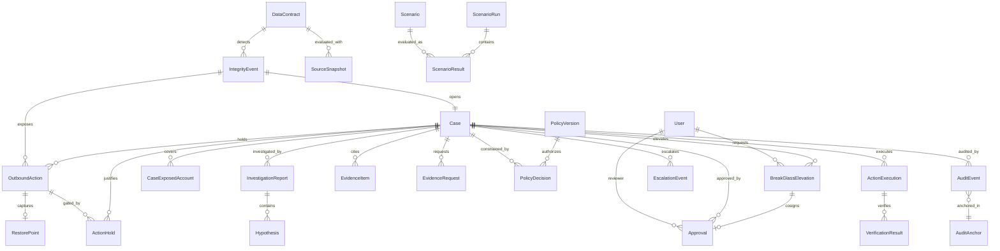

# BACKEND_SCHEMA — Data Model, Constraints and AuthZ

**Normative.** Prisma models in `prisma/schema.prisma` must match this file 1:1. If they diverge,
this file wins until it is deliberately amended (see `DECISIONS.md`).

Conventions: table names `snake_case` singular via `@@map`; ids are `cuid()`; timestamps are
`timestamptz`; money is integer minor units (`BigInt`); JSON columns are `jsonb`.

---

## 1. Table families

| Family | Prefix | Owner | Rule |
|---|---|---|---|
| Control plane | none (`Case`, `AuditEvent`, …) | control plane | read/write by `lib/*` |
| Reliability | `OutboxEvent`, `IdempotencyRecord`, `JobHeartbeat` | control plane infrastructure | written in the same transaction as the business change |
| Source mirrors | `src_*` | adapters only | read-only from control plane |
| Target system | `tgt_*` | target adapter only; write only via `lib/executor` | never joined with sources |
| Evaluation | `Scenario*` | eval harness | isolated from production flows |

## 2. Enums

```
Role                   VIEWER | ANALYST | REVIEWER | SENIOR_REVIEWER | ADMIN | AUDITOR
Severity               CRITICAL | HIGH | MEDIUM | LOW
IntegrityEventType     SCHEMA | ENUM | SEMANTIC | FRESHNESS | CROSS_SOURCE
IntegrityEventStatus   OPEN | DISMISSED | LINKED
OutboundActionType     ENTITLEMENT_REVOKE | ENTITLEMENT_GRANT | ACCOUNT_STATUS_CHANGE
OutboundActionStatus   PENDING | HELD | RELEASED | EXECUTED | BLOCKED | COMPENSATED
GateDecision           ALLOW | HOLD | BLOCK
CaseStatus             NEW | TRIAGED | HOLDING | INVESTIGATING | AWAITING_EVIDENCE
                       AWAITING_APPROVAL | APPROVED | REJECTED | SAFE_REFUSAL
                       EXECUTING | VERIFYING | CLOSED_RESOLVED | CLOSED_NO_ACTION
                       CLOSED_ESCALATED | REOPENED | ESCALATED
CaseMode               AGENT | DETERMINISTIC
Disposition            ALLOW | HOLD_FOR_EVIDENCE | BLOCK | RELEASE_AFTER_CORRECTION
                       | COMPENSATE | ESCALATE | SAFE_REFUSAL
ApprovalDecision       APPROVE | REJECT | OVERRIDE
ApprovalStatus         VALID | SUPERSEDED | EXPIRED | REVOKED
ExecutionKind          RELEASE | RESTORE_LAST_KNOWN_GOOD
ExecutionStatus        PENDING | SUCCEEDED | FAILED | UNKNOWN
EvidenceKind           CONTRACT_RECORD | BILLING_RECORD | USAGE_SIGNAL | SUPPORT_TICKET
                       | ACCOUNT_HISTORY | TARGET_STATE | OWNER_CONFIRMATION
EvidenceStance         SUPPORTS | CONTRADICTS | NEUTRAL
EvidenceRequestStatus  REQUESTED | RECEIVED | EXPIRED
HypothesisVerdict      SUPPORTED | REFUTED | OPEN
AccountStatus          ACTIVE | SUSPENDED | CLOSED
AccountSegment         ENTERPRISE | MIDMARKET | SMB
TargetEntitlementStatus ACTIVE | SUSPENDED | REMOVED
ServiceState           ENABLED | RESTRICTED | BLOCKED
ScenarioType           PREVENTION | COMPENSATION | CONFLICT | VERIFICATION_FAILURE
                       | SAFE_REFUSAL | FALSE_POSITIVE | IDEMPOTENCY | STALE_VALID
                       | AGENT_SECURITY
ScenarioRunStatus      RUNNING | PASSED | FAILED | ABORTED
ScenarioRunKind        DETERMINISTIC | AGENT | ADVERSARIAL | LOAD | CHAOS | DR
ActorType              SYSTEM | AGENT | USER | SERVICE
OutboxStatus           PENDING | PUBLISHING | DELIVERED | FAILED | DLQ
PolicyStatus           DRAFT | ACTIVE | RETIRED
BreakGlassStatus       PENDING_COSIGN | ACTIVE | USED | EXPIRED | DENIED | REVOKED
DegradationLevel       L0_NORMAL | L1_LLM_DEGRADED | L2_TARGET_DEGRADED
                       | L3_DB_DEGRADED | L4_AUDIT_BROKEN | L5_IDENTITY_DEGRADED
```

`ActorType.SERVICE` is used for `agent`, `target` and `ops` service principals; their `actorId` is the
principal name, never a key.

## 3. Identity and access

### `User`
| Column | Type | Constraints |
|---|---|---|
| id | text | PK, cuid |
| email | text | unique, lowercase-normalized |
| name | text | required |
| passwordHash | text | nullable — null for OIDC-only users |
| roles | `Role[]` | default `{VIEWER}` |
| oidcSubject | text | unique nullable (`issuer\|sub`) |
| sessionEpoch | int | default 0; bumped on role change or deactivation |
| isActive | boolean | default true |
| lastLoginAt | timestamptz | nullable |
| createdById | text FK | nullable |
| createdAt / updatedAt | timestamptz | auto |

Constraints, enforced by migration-level `CHECK` and `lib/rbac.ts`:

- `roles` must not contain `ADMIN` together with `REVIEWER`, `SENIOR_REVIEWER` or `AUDITOR`. Platform
  administration is not a business decision role (`RBAC.md` §2.1).
- `NODE_ENV=production` requires `oidcSubject` for every active user and refuses non-null
  `passwordHash` at startup (credentials login disabled).
- Roles are re-read from this table on every privileged request; never trusted from the session token.
  Deactivated user or a `sessionEpoch` mismatch ⇒ 401/403 `USER_INACTIVE`.
- Role changes are audited (`USER_ROLE_CHANGED`) and bump `sessionEpoch`.

Service principals are not `User` rows. They are env-backed keys with fixed names `agent`, `target`,
`ops`, and appear in audit as `(SERVICE, agent|target|ops)`.

## 4. Evidence sources (read-only mirrors)

### `src_contract_entitlement`
`id` PK · `recordRef` unique · `accountId` · `entitlementKey` · `status` (`TargetEntitlementStatus`)
· `contractVersion` · `effectiveFrom` · `effectiveTo` nullable · `payload` jsonb · `ingestedAt`
Index: `(accountId, entitlementKey)`, `(status)`.

### `src_billing_subscription`
`id` PK · `recordRef` unique · `accountId` · `planCode` · `planStatus` · `seats` int · `mrrMinor`
bigint · `periodStart` · `periodEnd` · `sourceUpdatedAt` · `payload` jsonb
Index: `(accountId)`, `(planStatus)`.

### `src_usage_event_daily`
`id` PK · `recordRef` unique · `accountId` · `featureKey` · `eventDate` date · `eventCount` int ·
`lastSeenAt`
Unique: `(accountId, featureKey, eventDate)`. Index: `(featureKey, eventDate)`.

### `src_support_ticket`
`id` PK · `recordRef` unique · `accountId` · `subject` · `body` · `status` · `severity` ·
`sourceCreatedAt` · `payload` jsonb
Index: `(accountId)`, `(sourceCreatedAt)`.

### `src_account_registry`
`id` PK · `accountId` unique · `name` · `segment` (`AccountSegment`) · `region` · `ownerTeam` ·
`accountStatus` (`AccountStatus`) · `sourceUpdatedAt` · `payload` jsonb

## 5. Target system (`tgt_*`)

### `tgt_account`
`id` PK · `accountId` unique · `name` · `status` (`AccountStatus`) · `updatedAt`

### `tgt_entitlement`
`id` PK · `accountId` · `entitlementKey` · `status` (`TargetEntitlementStatus`) · `grantedAt` ·
`revokedAt` nullable · `sourceRef` · `updatedAt`
**Unique:** `(accountId, entitlementKey)`. Index: `(entitlementKey, status)`.

### `tgt_service_status`
`id` PK · `accountId` unique · `state` (`ServiceState`) · `reason` · `updatedAt`

### `tgt_audit`
Append-only record of every target write.
`id` PK · `at` · `actor` · `operation` · `resourceType` · `resourceRef` · `beforeState` jsonb ·
`afterState` jsonb · `idempotencyKey` **unique** · `requestHash`

## 6. Control plane — contracts and detection

### `DataContract`
| Column | Type | Notes |
|---|---|---|
| id, key | text | `key` unique, e.g. `billing.plan_status` |
| name, sourceKey | text | `sourceKey ∈ billing \| contract \| usage \| support \| account` |
| fieldPath | text | dotted path inside source records |
| schemaHash | text | expected adapter projection schema hash |
| requiredFields | text[] | fields each projected row must include |
| version | int | incremented on semantic change |
| semanticDefinition | text | human-readable meaning used by the agent prompt; non-empty selects `semantic-check` over `enum-check` |
| expectedValues | text[] | declared value set |
| aliasMap | jsonb | `{ "CURRENT": "ACTIVE" }` declared equivalence, optional |
| invariants | jsonb | e.g. `[{ "otherSource": "contract", "rule": "status_implies_active" }]` |
| freshnessSlaSeconds | int | required |
| ownerTeam | text | responsible for semantic truth |
| status | text | `ACTIVE` \| `DEPRECATED` |

### `SourceSnapshot`
`id` PK · `sourceKey` · `contractId` nullable FK · `capturedAt` · `sourceUpdatedAt` ·
`schemaHash` · `payloadHash` · `rowCount` · `payload` jsonb
Unique: `(contractId, payloadHash)` — re-running a check on unchanged data is a no-op.
Index: `(sourceKey, capturedAt desc)`. Freshness is `capturedAt − sourceUpdatedAt`, never the DB
insert time.

### `IntegrityEvent`
`id` PK · `contractId` FK · `type` (`IntegrityEventType`) · `severity` (`Severity`) ·
`detectedAt` · `summary` text · `scopeSelector` jsonb (e.g. `{accountIds:[…]}` or
`{planStatus:["CURRENT"]}`) · `evidenceSnapshotIds` text[] · `status` (`IntegrityEventStatus`) ·
`fingerprint` **unique** (`sha256(contractId | type | payloadHash)`)
`dismissedReason`/`dismissedById`/`dismissedAt` are set together on `OPEN → DISMISSED`.
Index: `(status, detectedAt desc)`, `(severity)`.
`OPEN → LINKED` when a case is opened against it, `OPEN → DISMISSED` via `/dismiss`; both are terminal
for evaluation dedupe.

## 7. Control plane — actions, holds, cases

### `OutboundAction`
| Column | Type | Notes |
|---|---|---|
| id, ref | text | `ref` unique, `ACT-0001` |
| sourceAgent | text | e.g. `entitlement-sync-agent` |
| accountId | text | denormalized identifier, not an FK |
| actionType | `OutboundActionType` | |
| payload | jsonb | e.g. `{entitlementKey:"SSO", from:"ACTIVE", to:"REMOVED"}` |
| payloadHash | text | canonical JSON hash; idempotency comparison |
| requestedAt | timestamptz | |
| status | `OutboundActionStatus` | |
| gateDecision | `GateDecision` | `ALLOW`, `HOLD` or `BLOCK`; set once, immutable |
| gateEvaluatedAt | timestamptz | |
| idempotencyKey | text | **unique** |
| integrityEventId | text FK nullable | |
| caseId | text FK nullable | |
| restorePointId | text FK nullable | required for compensation eligibility |

Lifecycle (enforced in `lib/gate` and `lib/executor`, nowhere else): `PENDING → HELD` on `HOLD`,
`PENDING → EXECUTED` on `ALLOW`, `PENDING → BLOCKED` on gate `BLOCK`; `HELD → RELEASED → EXECUTED`
on an approved release; `HELD → BLOCKED` on a `BLOCK` disposition; `EXECUTED → COMPENSATED` after a
verified restore. No other transitions exist.

### `RestorePoint`
Captured immediately before any target write.
`id` PK · `outboundActionId` FK · `targetObjectType` (`entitlement` \| `service_status`) ·
`targetObjectRef` · `state` jsonb · `stateHash` · `capturedAt`
Unique: `(outboundActionId)`.

### `ActionHold`
`id` PK · `outboundActionId` FK · `caseId` FK · `reason` text · `placedAt` ·
`releasedAt` nullable · `releasedById` FK nullable
**Partial unique index:** `(outboundActionId) WHERE releasedAt IS NULL` (raw SQL migration).
A new hold on an already-held action is rejected with `ACTION_ALREADY_HELD`.

### `Case`
`id` PK · `ref` unique (`AIC-0001`) · `integrityEventId` FK · `title` · `status` (`CaseStatus`) ·
`severity` · `riskScore` int 0–100 · `riskBand` text (`LOW` \| `MEDIUM` \| `HIGH`, denormalized from
the latest `PolicyDecision`) · `exposureCount` int · `estimatedValueMinor` bigint ·
`reopenCount` int default 0 ·
`mode` (`CaseMode`) · `resolution` text nullable · `openedAt` · `lastTransitionAt` ·
`closedAt` nullable · `assignedToId` FK nullable · `slaDueAt` nullable ·
`approvalExpiresAt` nullable · `degradationLevel` (`DegradationLevel`) nullable (the level in force at
decision time)
Index: `(status, severity, openedAt desc)`, `(lastTransitionAt desc)`, `(approvalExpiresAt)`.

### `CaseExposedAccount`
Composite PK `(caseId, accountId)` · `outboundActionId` nullable · `externalRef` text
Index: `(accountId)`.

## 8. Control plane — investigation

### `InvestigationReport`
**Append-only.**
`id` PK · `caseId` FK · `runId` text (uuid per attempt) · `mode` (`CaseMode`) ·
`recommendedDisposition` (`Disposition`) · `confidence` numeric(3,2) · `evidenceCompleteness`
numeric(3,2) · `reasoning` text · `missingEvidence` text[] · `citations` jsonb
(`[{kind,ref,excerpt}]`) · `suspiciousContent` text[] default `{}` · `uncitedClaims` bool default false ·
`modelId` · `promptVersion` · `evidenceHash` · `isFallback` bool ·
`retried` bool default false · `tokensUsed` int nullable (null when `isFallback`) · `createdAt`
Unique: `(caseId, evidenceHash, promptVersion, mode)` — cache key.
Index: `(caseId, createdAt desc)`.

### `Hypothesis`
`id` PK · `caseId` FK · `reportId` FK · `statement` · `confidence` numeric(3,2) · `verdict`
(`HypothesisVerdict`) · `supportingRefs` text[] · `contradictingRefs` text[] · `position` int

### `EvidenceItem`
`id` PK · `caseId` FK · `kind` (`EvidenceKind`) · `sourceKey` · `recordRef` · `excerpt` ·
`stance` (`EvidenceStance`) · `capturedAt` · `addedById` FK nullable
Index: `(caseId, kind)`.

### `EvidenceRequest`
`id` PK · `caseId` FK · `ownerTeam` · `question` · `status` (`EvidenceRequestStatus`) ·
`requestedAt` · `dueAt` · `resolvedAt` nullable
Index: `(caseId)`, `(status, dueAt)`.

## 9. Control plane — decision, approval and execution

### `PolicyVersion`
Immutable document registry. Activation is explicit and audited.
`id` PK · `version` text unique (e.g. `2026.10.1`) · `hash` text unique (`sha256` of canonical
document) · `document` jsonb · `status` (`PolicyStatus`) · `reviewTicket` text · `activatedById` FK
nullable · `activatedAt` nullable · `retiredAt` nullable · `createdAt`
**Partial unique index:** `(status) WHERE status = 'ACTIVE'` — exactly one active policy.

### `PolicyDecision`
`id` PK · `caseId` FK · `reportId` FK nullable · `riskScore` · `riskBand` text ·
`disposition` (`Disposition`) · `allowedDispositions` text[] · `approvalRequired` bool ·
`requiredApprovals` int · `requiredRoles` text[] · `approvalExpiresAt` nullable ·
`reasons` jsonb · `policyVersion` · `policyHash` · `evidenceHash` · `inputsHash` ·
`isFallback` bool · `createdAt`
The latest row is authoritative. `inputsHash = sha256(evidenceHash|policyHash|reportId|riskScore|exposureCount)`.
`requiredApprovals` / `requiredRoles` are computed here, never in the UI or handler.

### `Approval`
`id` PK · `caseId` FK · `reviewerId` FK · `decision` (`ApprovalDecision`) ·
`disposition` (`Disposition`) · `rationale` text (min 20 chars when `REJECT` or `OVERRIDE`) ·
`reopenCount` int · `status` (`ApprovalStatus`) default `VALID` ·
`boundEvidenceHash` · `boundPolicyHash` · `boundReportId` FK · `expiresAt` ·
`breakGlass` bool default false · `elevationId` FK nullable · `createdAt`
**Unique:** `(caseId, reopenCount, reviewerId)` — one approval per reviewer per lifecycle. Quorum is
counted over distinct `reviewerId` with `status = VALID`. A superseded or expired approval is never
counted and never deleted. `disposition` **is** the approval's bound disposition (`boundDisposition`
in `RBAC.md`); there is one column, not two.

### `ActionExecution`
`id` PK · `caseId` FK · `outboundActionId` FK nullable · `reopenCount` int ·
`kind` (`ExecutionKind`) · `targetObjectType` · `targetObjectRef` · `restorePointId` nullable ·
`idempotencyKey` **unique** · `status` (`ExecutionStatus`) · `attemptCount` int default 1 (always 1
for target writes; no automatic retry) · `requestPayload` jsonb · `responsePayload` jsonb nullable ·
`failureCode` nullable · `resolvedByVerification` bool default false ·
`resolvedById` FK nullable · `resolvedAt` nullable · `startedAt` · `finishedAt` nullable
Index: `(caseId)`, `(status)`, `(startedAt)`.
`UNKNOWN → SUCCEEDED|FAILED` only through a verification read or an explicit manual resolution, never
through the executor.

### `VerificationResult`
**Append-only.**
`id` PK · `caseId` FK · `executionId` FK nullable (null for a `BLOCK`, which has no execution) ·
`expectedState` jsonb · `observedState` jsonb · `observedStateHash` ·
`passed` bool · `mismatches` jsonb (`[{field,expected,observed}]`) · `attemptCount` int ·
`checkedAt`

### `EscalationEvent`
**Append-only.**
`id` PK · `caseId` FK · `reason` text (`VERIFICATION_MISMATCH`, `SLA_EXPIRED`, `OWNER_REQUIRED`) ·
`ownerTeam` text · `note` text nullable · `createdById` FK nullable · `createdAt`
Index: `(caseId, createdAt)`.

### `BreakGlassElevation`
`id` PK · `caseId` FK · `requestedById` FK · `cosignedById` FK nullable · `status`
(`BreakGlassStatus`) · `reason` text (≥ 50 chars) · `caseRef` text (denormalized for audit) ·
`cosignExpiresAt` · `expiresAt` · `usedAt` nullable · `createdAt`
Constraints: `requestedById != cosignedById`; at most one `PENDING_COSIGN` or `ACTIVE` per admin (raw
SQL partial unique index); `expiresAt - createdAt <= interval '60 minutes'`.
The co-signature creates a normal `Approval` row with `breakGlass = true`; it is **one** approval and
does not bypass quorum — on a high-risk case it fills the senior slot, and a distinct reviewer
approval is still required.

### `AuditEvent`
**Append-only, hash-chained.**
`id` PK · `seq` bigserial unique · `caseId` nullable · `actorType` (`SYSTEM`\|`AGENT`\|`USER`\|`SERVICE`) ·
`actorId` nullable · `eventType` text · `payload` jsonb · `requestId` · `traceId` nullable ·
`ip` inet nullable · `userAgent` text nullable · `policyVersion` nullable · `policyHash` nullable ·
`prevHash` nullable · `hash` · `createdAt`
Canonical `eventType` values (the only ones code may write): `CASE_OPENED`, `GATE_DECISION`,
`HOLD_PLACED`, `CASE_TRANSITION`, `INVESTIGATION_STARTED`, `INVESTIGATION_COMPLETED`,
`AGENT_FALLBACK_USED`, `EVIDENCE_REQUESTED`, `EVIDENCE_ADDED`, `POLICY_EVALUATED`,
`POLICY_ACTIVATED`, `APPROVAL_RECORDED`, `APPROVAL_SUPERSEDED`, `APPROVAL_EXPIRED`,
`APPROVAL_REJECTED`, `CASE_ESCALATED`, `EXECUTION_STARTED`, `EXECUTION_SUCCEEDED`,
`EXECUTION_FAILED`, `EXECUTION_UNKNOWN`, `VERIFICATION_PASSED`, `VERIFICATION_FAILED`,
`EXECUTION_RECONCILED`, `IDEMPOTENCY_REPLAY`, `OUTBOX_DLQ`, `AUDIT_ANCHORED`,
`AUDIT_CHAIN_BROKEN`, `AUTHZ_DENIED`, `BREAK_GLASS_REQUESTED`, `BREAK_GLASS_GRANTED`,
`BREAK_GLASS_DENIED`, `BREAK_GLASS_USED`, `BREAK_GLASS_EXPIRED`, `BREAK_GLASS_REVOKED`,
`DEGRADATION_CHANGED`, `USER_ROLE_CHANGED`,
`KEY_ROTATED`, `JOB_FAILED`.
`INTEGRITY_DISMISSED` records a human dismissal with a reason hash.
Index: `(caseId, createdAt)`, `(eventType, createdAt desc)`, `(requestId)`, `(traceId)`.
Guard: DB trigger raises on `UPDATE` and `DELETE`; Prisma client extension refuses mutation.

### `AuditAnchor`
`id` PK · `fromSeq` bigint · `toSeq` bigint · `eventCount` int · `rootHash` · `previousAnchorHash`
nullable · `externalUri` · `externalEtag` nullable · `status` text (`WRITTEN` \| `VERIFIED` \|
`FAILED`) · `anchoredAt` · `verifiedAt` nullable
Unique: `(fromSeq, toSeq)`. Append-only.

## 10. Reliability tables

### `OutboxEvent`
`id` PK · `eventType` text · `aggregateType` text · `aggregateId` text · `payload` jsonb ·
`dedupeKey` text **unique** · `status` (`OutboxStatus`) default `PENDING` · `attemptCount` int default 0 ·
`maxAttempts` int default 8 · `nextAttemptAt` · `lastError` text nullable · `createdAt` ·
`deliveredAt` nullable · `deadLetteredAt` nullable
Index: `(status, nextAttemptAt)`, `(aggregateType, aggregateId)`.
Written in the same transaction as the business change. The publisher claims rows with
`FOR UPDATE SKIP LOCKED`; delivery is at-least-once and consumers must be idempotent.

### `IdempotencyRecord`
`id` PK · `scope` text (`route + ':' + actorType + ':' + actorId`) · `key` text ·
`requestHash` text · `status` text (`IN_PROGRESS` \| `COMPLETED`) · `responseStatus` int nullable ·
`responseBody` jsonb nullable · `resourceType` text nullable · `resourceId` text nullable ·
`createdAt` · `completedAt` nullable · `expiresAt`
**Unique:** `(scope, key)`. Same key + same `requestHash` ⇒ replay the stored response with
`meta.replayed = true`. Same key + different hash ⇒ 409 `IDEMPOTENCY_CONFLICT`, no work done.
Retention 30 days; never used as an audit record.

### `JobHeartbeat`
`job` text PK · `lastStartedAt` · `lastSuccessAt` nullable · `lastError` text nullable ·
`consecutiveFailures` int default 0
Updated by every scheduled job from `OPERATIONS.md` §2.

### `DegradationState`
`id` PK · `level` (`DegradationLevel`) · `reason` text · `setBy` text (`SYSTEM` \| `ADMIN` \|
`SERVICE_OPS`) · `changedAt`
Latest row is authoritative; each change also writes `DEGRADATION_CHANGED`.

## 11. Evaluation

### `Scenario`
`id` PK · `key` unique (e.g. `A-prevention-sso-revoke`) · `title` · `type` (`ScenarioType`) ·
`expectedReportDisposition` (`Disposition`) nullable · `expectedPolicyDisposition`
(`Disposition`) nullable · `fixturePath` · `suiteVersion` · `notes`

### `ScenarioRun`
`id` PK · `suiteVersion` · `kind` (`ScenarioRunKind`) · `mode` (`CaseMode`) ·
`status` (`ScenarioRunStatus`) · `commitSha` · `environment` · `modelId` nullable ·
`promptVersion` · `policyVersion` · `policyHash` · `startedAt` · `finishedAt` · `summary` jsonb ·
`triggeredById` FK nullable · `error` text nullable

### `ScenarioResult`
`id` PK · `runId` FK · `scenarioId` FK · `passed` bool · `expected` jsonb · `actual` jsonb ·
`durationMs` int · `details` jsonb
Unique: `(runId, scenarioId)`. `expected`/`actual` hold the assertion payload (gate, report
disposition, policy disposition, final status, target state); no assertion is stored as free text.
For `KIND = LOAD | CHAOS | DR`, results reference the drill report path in `details` instead of a
business scenario.

### `KpiSnapshot`
`id` PK · `capturedAt` · `windowStart` · `windowEnd` · `metrics` jsonb · `policyVersion` ·
`policyHash`

## 12. Relationships (ER)



`OutboxEvent`, `IdempotencyRecord`, `JobHeartbeat` and `DegradationState` are infrastructure and
deliberately have no FK to domain tables.

## 13. Critical constraints (each one prevents a specific incident)

| Constraint | Prevents |
|---|---|
| `OutboundAction.idempotencyKey` unique | duplicate automation submissions creating duplicate holds |
| Partial unique `ActionHold(outboundActionId) WHERE releasedAt IS NULL` | two open holds diverging |
| `ActionExecution.idempotencyKey` unique | double compensation |
| `tgt_entitlement(accountId, entitlementKey)` unique | duplicate entitlement rows making verification ambiguous |
| `Approval(caseId, reopenCount, reviewerId)` unique | the same reviewer counting twice toward quorum |
| Partial unique `PolicyVersion(status) WHERE status='ACTIVE'` | two policies deciding the same case |
| `IdempotencyRecord(scope, key)` unique | duplicate execution from a retried request |
| One `ACTIVE`/`PENDING_COSIGN` elevation per admin | an admin accumulating emergency power |
| `User` check: `ADMIN` cannot hold reviewer roles | platform admin approving business actions |
| `IntegrityEvent.fingerprint` unique | alert storms from the same unchanged data |
| `InvestigationReport(caseId,evidenceHash,promptVersion,mode)` unique | unbounded LLM spend on identical evidence |
| `SourceSnapshot(contractId,payloadHash)` unique | re-evaluating identical snapshots |
| `AuditEvent` no-update/no-delete rule | tampering with the decision record |
| `VerificationResult` append-only | "verified" claims being rewritten after failure |
| `OutboxEvent.dedupeKey` unique | duplicate side effects from a retried transaction |

## 14. Authorization model

The full matrix is `RBAC.md`. Summary:

- **No row-level user ownership.** Cases belong to the organisation; access is permission-based.
  Rationale: operators must see all cases during an incident (ADR-008).
- Human roles: `VIEWER`, `ANALYST`, `REVIEWER`, `SENIOR_REVIEWER`, `ADMIN`, `AUDITOR`. Only
  `REVIEWER`+ approve; only `SENIOR_REVIEWER` approves high risk; `ADMIN` cannot approve or execute;
  `AUDITOR` cannot mutate.
- Approver ≠ executor, enforced at execute time. High risk or exposure ≥ 250 needs two approvals,
  one from a `SENIOR_REVIEWER`.
- Service principals: `agent` (ingest/evaluate/source read), `target` (target write), `ops`
  (reconcile/outbox/anchor). They cannot read console APIs.

## 15. Write-path summary and transaction boundaries

| Operation | Tables touched (one transaction) | Outside the transaction |
|---|---|---|
| Contract evaluation | `SourceSnapshot` → `IntegrityEvent` | — |
| Action ingest | `OutboundAction` → `Case` → `CaseExposedAccount` → `ActionHold` → `AuditEvent` → `OutboxEvent` | `ALLOW` target write by executor |
| Investigation | `InvestigationReport` + `Hypothesis` + `EvidenceItem`/`EvidenceRequest` → supersede approvals → `Case.status` → `AuditEvent` | Gemini call |
| Policy | `PolicyDecision` → `Case.riskBand` → `AuditEvent` | — |
| Approval | `Approval` → optional `Case.status = APPROVED` → `AuditEvent` → `OutboxEvent` | — |
| Execution | `ActionExecution` → approvals consumed → `Case.status = EXECUTING` → `AuditEvent` → `OutboxEvent` | target adapter write |
| Target write result | `ActionExecution.status` → `Case.status = VERIFYING` → `AuditEvent` | target write (already happened) |
| Verification | `VerificationResult` → execution resolution → `Case.status` → `AuditEvent` | target read |
| Policy activation | `PolicyVersion` (retire old) → `AuditEvent` → `OutboxEvent` | — |

Rules:

- The target write is intentionally **outside** the database transaction. A database transaction
  cannot span the HTTP call without holding locks during a network timeout, and a rollback cannot undo
  a write that already happened. The executor therefore commits intent first, writes second, and
  reconciles by reading state (`FAILURE_MODES.md` F-04/F-06/F-14).
- Every row above is written with its `AuditEvent`; a transition without an audit row is a defect.
- Every side effect that must happen after commit (notification, anchor, KPI snapshot) is an
  `OutboxEvent` written in the same transaction, never a fire-and-forget call.
